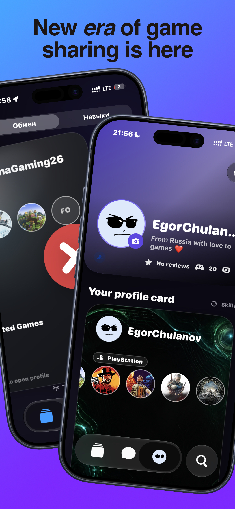
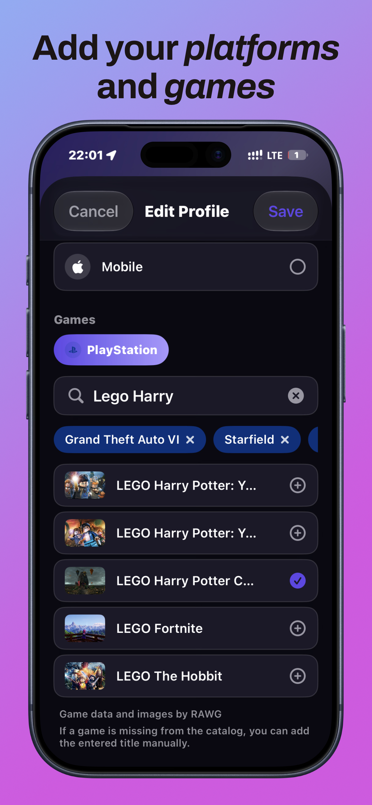
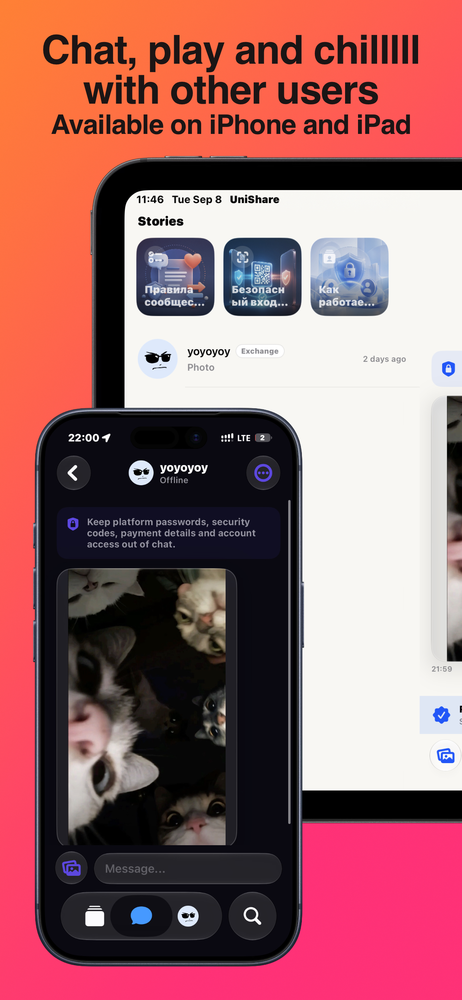
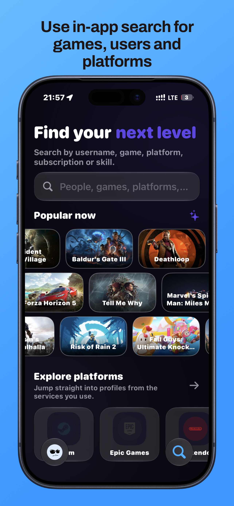
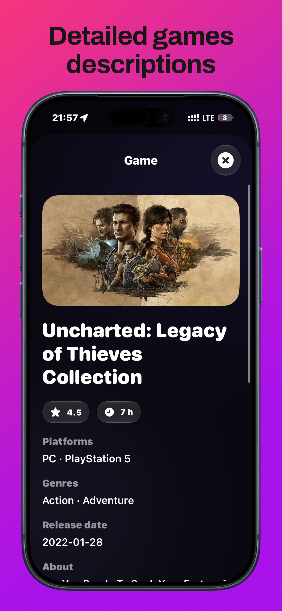
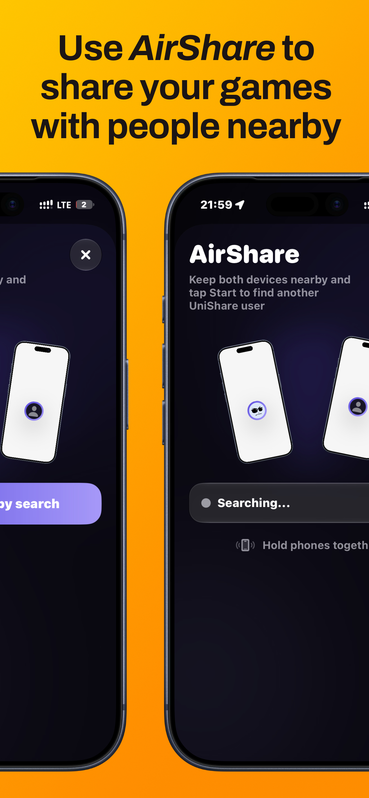

<div align="center">
  
  <h1>UniShare: Games Sharing</h1>
  <p>A cross-platform social app for finding teammates and swapping game libraries across PlayStation, Xbox, Nintendo, Steam, Epic Games, and more: in Telegram, VK, the browser, and on iOS.</p>

  <p>
    <a href="https://github.com/EgorChulanov/UniShare/actions"></a>
    <a href="https://t.me/UniversalShareBot"></a>
    <a href="cloud/README.md"></a>
    <a href="cloud/README.md"></a>
    <a href="https://github.com/EgorChulanov/UniShare"></a>
    <a href="https://github.com/EgorChulanov/UniShare"></a>
  </p>
</div>

## About

UniShare helps people discover teammates and compatible game libraries on **PlayStation, Xbox, Nintendo, Steam, Epic Games**, and other platforms:
- create a profile with the games you own and the games you want;
- swipe through compatibility-ranked profiles;
- match through mutual interest and continue in a private chat.

One account, one database and one adaptive interface serve every surface:

| Surface | Where |
| --- | --- |
| **Telegram Mini App** | [@UniversalShareBot](https://t.me/UniversalShareBot): opens like a native app; matches and messages are announced by the bot |
| **VK Mini App** | VK Mini Apps catalog (searchable inside VK) |
| **Web / PWA** | Any browser; installable to the home screen on iPhone, iPad and Android |
| **iOS (SwiftUI)** | The native app in [`UniShare/`](UniShare) |

Users sign in with the platform they open UniShare from. Telegram and VK can be linked to the same profile, and partners can opt in to share a direct Telegram or VK contact after a match.

> UniShare is a discovery and communication platform, not a seller or technical intermediary. It never asks for or stores gaming-service passwords, payment details, recovery codes, or two-factor authentication codes, and it never transfers an account on a user's behalf. Users must review each platform's rules and assess the risks before arranging any exchange.

## Product Preview

These App Store presentation mockups show the current product direction and core user experience.

<div align="center">
  
  
  
  
  
  
</div>

## Features

| Area | What it provides |
| --- | --- |
| **Discovery Feed** | Compatibility-ranked profiles, swipe actions, platforms, owned games, and wanted games |
| **Profiles** | Avatars, gaming accounts, libraries, subscriptions, platforms, and card customization |
| **Search** | Discovery by username, game, platform, subscription, or skill |
| **Chats** | Real-time exchange conversations, images, read states, reporting, blocking, and swipe-to-delete |
| **Stories** | Square community stories with multiple slides managed through Supabase |
| **AirShare** | Optional nearby public-profile discovery through Multipeer Connectivity |
| **Safety** | Reports, blocks, content filtering, rate limits, and permanent account deletion |
| **Widgets** | Home Screen and Control Center integrations through an App Group |
| **Localization** | English, Russian, Ukrainian, and Belarusian |

## Architecture

```text
cloud/                    # Telegram Mini App, VK Mini App, web/PWA and the shared API
├── shared/               # API contract, catalogs, validation, deep links, i18n
├── server/               # Node.js + Fastify API, WebSocket chat, Telegram bot, PostgreSQL migrations
├── web/                  # React client with one adaptive "Liquid Glass" UI for every screen size
└── deploy/               # docker-compose (PostgreSQL + app + HTTPS), one-command VPS installer

UniShare/                 # native iOS app (SwiftUI)
├── Core/                 # environment, theme, localization, haptics
├── Features/             # Auth, Onboarding, Feed, Search, Chat, AirShare, Profile
├── Models/               # profiles, chats, stories, reviews
├── Services/             # Supabase, Storage, RAWG, push notifications
├── Cache/                # avatars, games, and user data
├── Components/           # reusable SwiftUI components
└── Resources/            # fonts, assets, and App Icon

supabase/
├── migrations/           # schema, RLS, RPC, and Storage policies
├── functions/            # game-search, delete-account, send-push, legal
└── seed.sql              # local stories and demo data
```

## Technology

**Cloud (Telegram, VK, web):**
- TypeScript end to end: React 19, Vite and Framer Motion on the client; Fastify, WebSockets and grammY on the server.
- PostgreSQL 14+ with plain SQL migrations, hosted in Russia (Yandex Cloud recommended).
- Storage on the local disk or any S3-compatible bucket (Yandex Object Storage).
- Telegram Mini Apps (full-screen mode, safe areas, haptics, LocationManager for AirShare, `shareMessage`), VK Bridge, PWA.
- The web client repeats the iOS design: Liquid Glass tab bar, stories, swipe cards, in-app search, game pages and AirShare.

**iOS:**

- Swift 5.9, SwiftUI, iOS 16.1+, and iPadOS
- Supabase Auth, PostgreSQL, Realtime, Storage, and Edge Functions
- Swift Package Manager and XcodeGen
- RAWG through a server-side proxy and cache for game metadata and artwork
- Multipeer Connectivity, CoreBluetooth, WidgetKit, and CoreHaptics
- Manrope, Archivo Black, and Plus Jakarta Sans

## Quick Start

### Telegram, VK and web (`cloud/`)

```bash
cd cloud
cp .env.example .env
npm install
npm run dev      # API :8080 + web :5173, use "Test sign-in" locally
```

Production deployment, with BotFather, VK and Yandex Cloud set up step by step, is covered in [docs/LAUNCH_GUIDE_RU.md](docs/LAUNCH_GUIDE_RU.md) and [cloud/README.md](cloud/README.md).

### iOS app

```bash
git clone https://github.com/EgorChulanov/UniShare.git
cd UniShare
make bootstrap
```

Create `Config/Secrets.xcconfig` from the template:

```xcconfig
SUPABASE_URL = https:/$()/PROJECT_REF.supabase.co
SUPABASE_PUBLISHABLE_KEY = sb_publishable_YOUR_KEY_HERE
SUPABASE_ANON_KEY = $(SUPABASE_PUBLISHABLE_KEY)
```

Do not write `https://` directly in an `.xcconfig` value because Xcode interprets `//` as a comment. The RAWG API key belongs only in a Supabase Edge Function secret:

```bash
supabase secrets set RAWG_API_KEY=your_key_here
```

After selecting your Development Team in Xcode:

```bash
make generate
make open
```

See [Supabase setup](docs/SUPABASE_SETUP.md) for the complete backend guide.

## Supabase and DataGrip

The repository includes safe administrative SQL consoles for hosted and local databases:

- [00_health.sql](datagrip/00_health.sql): connection and RLS health checks
- [10_users_readonly.sql](datagrip/10_users_readonly.sql): read-only user inspection
- [21_stories_admin.sql](datagrip/21_stories_admin.sql): story creation and management
- [30_moderation_readonly.sql](datagrip/30_moderation_readonly.sql): reports and moderation
- [50_game_catalog_admin.sql](datagrip/50_game_catalog_admin.sql): game catalog maintenance and RAWG key rotation

See the [DataGrip workspace guide](datagrip/README.md) and [operations manual](docs/DATAGRIP_OPERATIONS.md).

## Testing and CI

```bash
make test-static       # static validation
make test-backend      # local migrations and security smoke tests
make test-e2e          # deterministic multi-user API E2E
make ci-ios-tests      # unit and UI tests through xcodebuild
make cloud-test        # cloud typecheck + API tests on PostgreSQL
```

GitHub Actions validates the project, runs automated tests, and provides a protected TestFlight workflow. Supabase, App Store Connect, and signing credentials must remain in GitHub Environments and must never be committed.

## Security

- Row Level Security protects user tables and Storage objects.
- The iOS client never receives a database password or `service_role` key.
- Game search runs through an Edge Function with server-side caching.
- Account deletion removes related application data and uploaded files.
- Public profiles never expose gaming-service credentials.

Read the [security review](docs/SECURITY_REVIEW.md) for implemented controls, verified scenarios, and remaining release work.

## App Store Resources

Metadata, localizations, privacy and support pages, and release procedures live alongside the source:

- [App Store Connect values](docs/APP_STORE_CONNECT_VALUES.md)
- [Release guide](docs/APP_STORE_RELEASE.md)
- [Privacy policy](docs/privacy.html)
- [Terms of use](docs/terms.html)
- [Fastlane metadata](fastlane/metadata/)

## Status

UniShare is under active development. The cloud version (Telegram, VK, web) runs on its own PostgreSQL-backed server, documented in [cloud/README.md](cloud/README.md). The iOS app still uses the Supabase backend in [`supabase/`](supabase) until it is migrated to the shared API.

## Author

**Egor Chulanov**, developer and creator of UniShare

- GitHub: [@EgorChulanov](https://github.com/EgorChulanov)
- Repository: [EgorChulanov/UniShare](https://github.com/EgorChulanov/UniShare)
